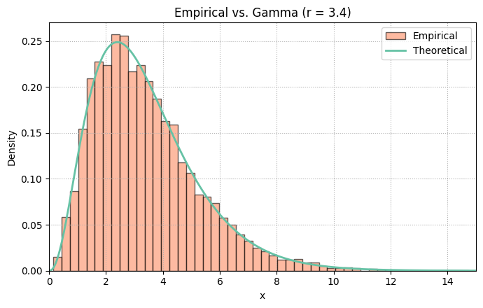
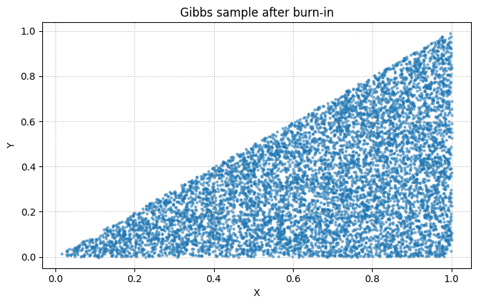

# Sampling Probability Distributions

Monte Carlo experiments connecting probability theory to simulated data: inverse transforms, composition, rejection sampling, Box–Muller, and Gibbs sampling. The objective is to compare empirical distributions with their theoretical PMFs and PDFs.

**[Full report](docs/report.pdf)** · [Main notebook](notebooks/sampling.ipynb) · [Research and reproducibility notes](docs/research-notes.md)

## Methods and experiments

The project uses synthetic random samples only; no external dataset is required. Experiments cover Bernoulli, binomial, geometric, negative binomial, hypergeometric, Poisson, uniform, exponential, gamma, beta, and normal distributions, plus a uniform joint density on `0 < y < x < 1`.

- Inverse transforms generate uniform and exponential samples.
- Sums of exponentials generate integer-shape gamma samples; an exponential proposal supports rejection sampling for shape 3.4.
- Ratios of gamma draws generate Beta(3, 6); Box–Muller generates standard normals.
- Poisson counts come from exponential interarrival times.
- Gibbs sampling alternates the triangle's uniform conditional distributions: 10,000 states, with 2,000 discarded as burn-in.

The final notebook uses NumPy's built-in samplers for several discrete distributions. The [earlier exploration](notebooks/sampling_exploration.ipynb) preserves manual implementations closer to parts of the report. These are distinct experimental versions, not interchangeable reproductions.

## Results

The report concludes that empirical histograms and scatterplots visually agree with the target distributions. It does not report formal goodness-of-fit tests, timing benchmarks, or MCMC convergence diagnostics.

The final notebook's stored rejection-sampling output reports an envelope constant of **2.757** and **10,000 accepted samples from 27,689 proposals (36.1%)**. These are historical notebook values, not a new validation result.





## Reproduce

Use Python 3.11 or 3.12. From this repository:

```bash
python -m venv .venv
# Windows PowerShell: .venv\Scripts\Activate.ps1
# macOS/Linux: source .venv/bin/activate
python -m pip install -r requirements.txt
jupyter lab notebooks/sampling.ipynb
```

Select the environment's kernel and run all cells in order. The main notebook retains seed 42 and the original sample sizes, including a ten-million-draw gamma experiment that requires substantial memory. Historical outputs and exported figures remain available without execution; a rerun does not overwrite the figures.

To save a separate executed notebook:

```bash
jupyter nbconvert --to notebook --execute notebooks/sampling.ipynb --output sampling-rerun --output-dir results/rerun --ExecutePreprocessor.timeout=1200
```

## Repository

| Path | Contents |
| --- | --- |
| `notebooks/sampling.ipynb` | Final experiments with execution fixes |
| `notebooks/sampling_exploration.ipynb` | Earlier manual algorithms and exploratory results |
| `figures/` | Original exported figures |
| `docs/report.pdf` | Full May 2025 report; student identifier redacted |
| `docs/research-notes.md` | Code/report differences, fixes, and limitations |

Written by Genrikh Vetsler for Mathematical Statistics at University College Roosevelt (Spring 2025). The notebook versions differ in parameters and conventions; see the research notes before interpreting individual plots as exact reproductions of the paper.
